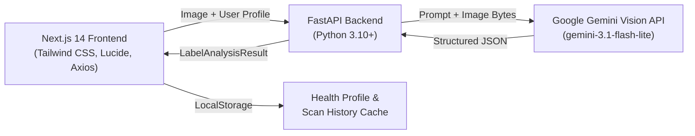

# 🔍 LabelTruth

> **Transparent Food Labeling, FSSAI Regulatory Auditor & Clinical Health Engine**  
> Grounded in primary consumer research across 51 respondents ($N=51$) and powered by multimodal Gemini Vision & FSSAI 2020 regulatory compliance frameworks.

---

## 📌 Problem Overview
Front-of-pack claims in India frequently deceive consumers through sophisticated marketing tactics:
- **Disguised Sugars**: Brands split sugars into 3–4 aliases (maltodextrin, liquid glucose, invert syrup, dextrose) to prevent sugar from appearing as the first ingredient under FSSAI Regulation 5(2)(b).
- **Atta / Brown Bread Dyeing**: Products labeled as "Brown Bread" or "Atta" often use Maida as the primary grain and add INS 150d (Caramel Colour IV) to dye white flour brown.
- **The "Ice Cream" Loophole**: Substituting milk fat with hydrogenated vegetable oils legally turns ice cream into a "Frozen Dessert," yet packaging mimics dairy ice cream.
- **Health Profile Mismatches**: Individuals with diabetes, hypertension, celiac disease, or food allergies lack real-time tools to cross-reference ambiguous chemical additives against their specific clinical restrictions.

**LabelTruth** solves this by offering a zero-hardcoded-product, 100% dynamic AI audit engine that reads real food labels, flags deceptive marketing, audits FSSAI compliance, checks personalized medical safety, and provides clean whole-food alternatives.

---

## ✨ Core Features

### 1. 📷 Dual-Input Forensic Label Scanner (`/scan`)
- **Live Camera Stream**: Real-time camera feed via HTML5 `navigator.mediaDevices.getUserMedia` for instant packaging capture.
- **File Upload / Drag-and-Drop**: Upload screenshots from quick-commerce apps (Blinkit, Zepto, Swiggy Instamart, Amazon).
- **Preset Demonstration Suite**: Instant 1-click presets (Brown Bread, Zero-Sugar Drink, Hazelnut Spread) for quick testing.

### 2. 🧠 Multimodal Gemini Vision Audit (`POST /api/analyze-label`)
- **FSSAI 2020 Compliance Engine**: Automatically audits Regulation 5(2)(b) descending weight order, checks prohibited front-of-pack claims, and flags deceptive marketing.
- **INS Code Decoder**: Analyzes industrial food additives (e.g., INS 150d Caramel Colour IV, INS 621 MSG, INS 102 Tartrazine, INS 211 Sodium Benzoate, Maltodextrin).
- **Traffic Light Health Scoring**: Generates an evidence-based 0–100 Health Score, clear layperson summary, itemized ingredient concern levels (`LOW`, `MEDIUM`, `HIGH`), and clean Indian alternatives.

### 3. 🛡️ Personalized Health Memory Profile
- **Device-Local Storage**: Stored client-side in `localStorage` for complete data privacy.
- **Clinical & Metabolic Conditions**: Type-2 Diabetes, Celiac Disease / Gluten Sensitivity, Hypertension (High BP), Lactose Intolerance, Hyperuricemia (Gout), Chronic Kidney Disease, PKU, High Cholesterol, NAFLD.
- **Allergies & Sensitivities**: Peanuts, Tree Nuts, Soy, Shellfish, Sesame, Gluten, Dairy, Sulfites, Eggs.
- **Dietary Choices**: Vegan, Vegetarian, Jain, Halal, Eggless.
- **AI-Verified Custom Additives**: Add custom ingredients or conditions (e.g. *Maltitol*, *Tartrazine*, *Histamine Intolerance*) with real-time AI validation via Gemini Flash (`POST /api/validate-condition`) and dedicated badge management with removal controls.

### 4. 💬 Grounded Clinical AI Chatbot
- Sticky floating clinical assistant in `/scan`.
- **Product-Grounded Intelligence**: Automatically reads the currently scanned label's product name, health score, FSSAI flags, and ingredient breakdown to answer follow-up queries specifically tailored to the active product.
- **Strict Scope Locking**: Politely rejects off-topic queries (coding, trivia, sports) to maintain clinical focus and conserve tokens.
- **Structured Output**: Enforces concise, clinical takeaways, key facts with biological mechanisms, and actionable recommendations.

### 5. 📂 Previously Scanned Products Tab
- Automatically logs all scanned products to local device storage with label preview thumbnails.
- Shows timestamp, health score (0–100), verdict badge (`SAFE FOR YOU`, `CAUTION`, `AVOID`), and flagged violations.
- One-click **"View Full Insights"** to re-open the complete forensic breakdown and reconnect the AI Chatbot context.
- Dedicated **"Clear History"** action to reset local history.

### 6. 📊 Cited FSSAI Literacy Hub (`/`)
- Interactive modules explaining key FSSAI 2020 regulations.
- Cited statistic cards directly grounded in primary survey data ($N=51$) and research literature.
- Access to the original research report (`pm hve report .pdf`) and raw survey dataset (`The Indian Food Label Challenge (Responses).xlsx`).

---

## 🏗️ Architecture & Tech Stack



- **Frontend**: Next.js 14 (App Router), React 18, TypeScript, Tailwind CSS ("Editorial Minimalist / Modern Clinical" theme), Lucide Icons, Axios.
- **Backend**: Python FastAPI, Uvicorn, Pydantic v2, `google-genai` SDK (`gemini-3.1-flash-lite`), Pillow.

---

## 🚀 Quickstart & Installation

### Prerequisites
- Node.js 18+ and npm
- Python 3.10+
- Google Gemini API Key ([Google AI Studio](https://aistudio.google.com/))

### 1. Clone & Set Up Environment Variables
```bash
# Clone the repository
git clone https://github.com/your-username/LabelTruth.git
cd LabelTruth

# Configure backend environment
cd backend
cp .env.example .env # or create .env
```
Inside `backend/.env`:
```env
GEMINI_API_KEY="YOUR_GEMINI_API_KEY_HERE"
HOST="0.0.0.0"
PORT=8000
```

Inside `frontend/.env.local`:
```env
NEXT_PUBLIC_API_URL="http://localhost:8000"
```

---

### 2. Start the Backend
```bash
cd backend
python -m venv venv
# On Windows:
venv\Scripts\activate
# On Linux/macOS:
source venv/bin/activate

pip install -r requirements.txt
python run.py
```
*Backend runs on `http://127.0.0.1:8000` (API documentation at `/docs`).*

---

### 3. Start the Frontend
```bash
cd frontend
npm install
npm run build
npm run start
# Or for development: npm run dev
```
*Frontend runs on `http://localhost:3000`.*

---

## 📡 API Reference

| Endpoint | Method | Payload / Params | Description |
|---|---|---|---|
| `/api/health` | `GET` | — | Health check status |
| `/api/stats` | `GET` | — | N=51 Primary Survey statistics & FSSAI norms |
| `/api/presets` | `GET` | — | Instant demo products & sample audits |
| `/api/analyze-label` | `POST` | `multipart/form-data`: `image` (file), `user_profile` (JSON string) | Multimodal Gemini Vision label audit |
| `/api/validate-condition` | `POST` | `{"condition": string}` | AI condition/additive validation |
| `/api/chat` | `POST` | `{"message": string, "history": [...], "user_profile": {...}, "product_context": {...}}` | Clinical grounded AI chatbot |

## 🧪 Testing

LabelTruth includes a comprehensive automated test suite for both backend APIs and frontend UI components:

### Run Backend Tests (Pytest)
Backend unit tests mock external Gemini Vision and GenAI network calls via `pytest-mock` so they execute 100% offline without requiring an active API key or consuming quota:
```bash
cd backend
python -m pytest tests/test_main.py -v
```
**Tests covered:**
- `test_health_check`: Verifies service status and heartbeat.
- `test_get_survey_and_fssai_stats`: Validates survey data ($N=51$) and FSSAI regulation schemas.
- `test_get_demo_presets`: Verifies rapid demonstration presets.
- `test_validate_condition`: Tests AI-driven health condition/additive verification with mock responses.
- `test_chat_endpoint`: Tests scope-locking and formatted nutritionist replies.
- `test_analyze_label_endpoint`: Tests multipart image upload parsing and structured FSSAI audits.

---

### Run Frontend Tests (Vitest & React Testing Library)
Frontend smoke and component tests verify rendering and accessibility:
```bash
cd frontend
npm test
```

---

### Continuous Integration (CI)
GitHub Actions automatically runs both backend Pytest and frontend Vitest suites on every push and pull request via [`.github/workflows/test.yml`](.github/workflows/test.yml).

---

## ⚖️ Legal & Medical Disclaimer
> **Disclaimer**: LabelTruth is an AI-powered educational and consumer protection tool designed to decode food labels, ingredient lists, and FSSAI regulatory compliance. It does not provide clinical medical diagnosis, treatment, or medical nutrition therapy. Always consult a qualified physician or registered dietitian for personal medical conditions.

