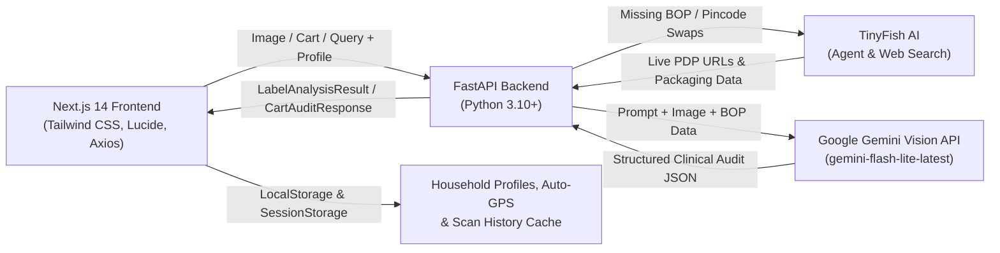

# 🔍 LabelTruth

> **Transparent Food Labeling, FSSAI Regulatory Auditor & Clinical Health Engine**  
> Grounded in primary consumer research across 51 respondents ($N=51$) and powered by multimodal Gemini Vision & FSSAI 2020 regulatory compliance frameworks.

---

## 📌 Problem Overview
Front-of-pack claims in India frequently deceive consumers through sophisticated marketing tactics:
- **Disguised Sugars**: Brands split sugars into 3–4 aliases (maltodextrin, liquid glucose, invert syrup, dextrose) to prevent sugar from appearing as the first ingredient under FSSAI Regulation 5(2)(b).
- **Atta / Brown Bread Dyeing**: Products labeled as "Brown Bread" or "Atta" often use Maida as the primary grain and add INS 150d (Caramel Colour IV) to dye white flour brown.
- **The "Ice Cream" Loophole**: Substituting milk fat with hydrogenated vegetable oils legally turns ice cream into a "Frozen Dessert," yet packaging mimics dairy ice cream.
- **Health Profile Mismatches**: Individuals with diabetes, hypertension, celiac disease, acidity/GERD, or food allergies lack real-time tools to cross-reference ambiguous chemical additives against their specific clinical restrictions.

**LabelTruth** solves this by offering a zero-hardcoded-product, 100% dynamic AI audit engine that reads real food labels, flags deceptive marketing, audits FSSAI compliance, checks personalized medical safety, and provides clean whole-food alternatives.

---

## ✨ Core Features

### 1. 🛒 Autonomous Quick-Commerce Cart Audit (Zepto & Blinkit)
Audit your entire grocery cart before checkout to eliminate hidden chemical additives:
- **Dual Input Modes**: Upload a screenshot of your quick-commerce checkout screen or paste a shared cart link.
- **TinyFish Autonomous Browser Agent**: For cart links, launches a headless desktop browser session to bypass Cloudflare/WAF bot challenges, navigate the cart DOM, wait for client hydration, and extract all cart line items, brands, quantities, and visible labels.
- **Multi-Stage Progressive Loading**: Dynamic visual feedback across 4 audit phases ("Launching TinyFish Browser...", "Extracting cart items...", "Auditing against FSSAI & Health Profile...", "Searching live dark-store inventory for clean swaps...").
- **Deep Back-of-Pack Extraction & Gemini Clinical Audit**: For every cart item, TinySearch and TinyFetch retrieve authentic packaging panels and feed them to Gemini AI for deep clinical analysis, tailored contraindication warnings, and FSSAI 2020 compliance verification.
- **Cart Health Transformation**: Computes the **Original Cart Health Score** vs. **Upgraded Cart Score** (e.g. `40/100 -> 88/100 (+48 pts cleaner)`) and totals the harmful additives removed.
- **Category-Based Clean Swapping**: Recommends superior, whole-food alternatives in the exact same food category (e.g. *The Whole Truth Roasted Makhana* or *Slurrp Farm Ragi Puffs* for fried namkeen; *Early Foods Sprouted Ragi Cocoa* for sugary malt drinks).
- **Strict Anti-Same-Product Filter**: Guarantees the swap is a distinct, cleaner brand—never recommending the same ultra-processed product back to the user.
- **Direct Product Detail Page (PDP) Links**: TinyFish agent navigates to the matching clean alternative and captures verified 1-click product detail page URLs on Zepto or Blinkit at your delivery pincode.


### 2. ⚖️ Head-to-Head Product Comparison
Compare two packaged snacks, beverages, or groceries side-by-side:
- **Dual-Input Scanner**: Upload photos or type product names for **Product 1** and **Product 2** simultaneously.
- **Side-by-Side Nutrition Matrix**: Compares **Calories**, **Added Sugars**, **Saturated Fat / Palm Oil**, **Flagged Additives**, and **Health Score** in real time.
- **Forensic Audit Verdict Banner**: Highlights the superior choice and calculates the exact score differential (e.g., *Product A is significantly cleaner (+24 pts better)*).

### 3. 📷 Smart Hybrid Scanner & TinyFish Fallback Engine (`/scan`)
- **Direct Text Search**: No photo? Type any packaged product name (e.g. *"Bournvita Little Champs"*, *"Epigamia Greek Yogurt"*) or paste a quick-commerce URL to auto-extract packaging data.
- **Live Camera Stream**: Real-time camera feed via HTML5 `navigator.mediaDevices.getUserMedia` for instant packaging capture.
- **File Upload / Drag-and-Drop**: Upload screenshots from quick-commerce apps (Blinkit, Zepto, Swiggy Instamart, Amazon).
- **Comprehensive Partial Photo Logic**:
  - *Front-of-pack only*: Automatically extracts product name and invokes TinyFish to pull back-of-pack ingredients and nutrition.
  - *Ingredients only*: Detects absence of nutrition facts and fetches the complete nutritional table online.
  - *Nutrition card only*: Detects absence of ingredients and fetches the full ingredient breakdown online.
- **Non-Food Image Guard**: Gemini Vision rejects irrelevant non-food photos (e.g., animals, cars, walls) with a clean HTTP 400 rejection.

### 4. 🐟 TinyFish AI Autonomous Web Navigation & Extraction
LabelTruth integrates **TinyFish AI** as an autonomous browser agent layer for real-time quick-commerce search and live stock verification:
- **Autonomous PDP Discovery**: Navigates quick-commerce platforms (Zepto, Blinkit, Swiggy Instamart) with delivery pincode context, clicks through search results, and captures verified Product Detail Page (PDP) URLs.
- **TinyFetch Extraction**: Deep-fetches and parses unstructured DOM content from online product listings, isolating ingredient lists, allergen statements, and nutrition tables.
- **Credit-Smart Alternative Checking**: For products scoring 85 or 85+, the AI checks whether an even cleaner alternative actually exists on the Indian market. If the product is already at peak purity (e.g. 100% single-ingredient oats or cold-pressed oil), external search calls are skipped, saving significant API credits.

### 5. 🩺 Dynamic Disease-Severity Scoring, ICMR-NIN Whole-Food Matrix & Profile Evaluator
- **Justifiable Whole-Food Matrix Scoring (ICMR-NIN 2024 & FSSAI 2020)**: Pure whole foods (100% peanut butter, nuts, cold-pressed oils, pure A2 ghee, seeds) are spared from artificial caloric density penalties and saturated fat deductions when free from industrial palm oil/trans fats. Whole-food items score 88–98/100 instead of losing 30+ points for natural intrinsic fats.
- **Severity-Based Point Deductions**:
  - **Severe Allergies & Celiac**: Deducts **-30 to -50 points**, sets verdict to `AVOID (VIOLATES PROFILE)`, and triggers urgent clinical warnings.
  - **Metabolic Conditions (Diabetes, Hypertension, Fatty Liver)**: Proportional deductions (**-15 to -25 points**) for high-GI sugars (maltodextrin GI 110), excess sodium, MSG, or trans fats.
  - **Digestive Sensitivities (Acidity, Acid Reflux, GERD, Gastritis, IBS)**: Justifiable deductions (**-8 to -18 points**) for triggering ingredients (Citric Acid `INS 330`, carbonation, artificial souring agents, caffeine, spicy irritants) with explicit flare-up risk explanation (~70% likelihood of acidity flare-up).
- **30-Day Cache Freshness & Instant Profile Revision**: Product audits are cached for up to 30 days (`CACHE_TTL_SECONDS = 30 * 24 * 3600`) to respect API credits while tracking manufacturer recipe reformulations. Modifying any profile medical condition, allergy, or dietary restriction instantly invalidates the safety evaluation and triggers an immediate fresh clinical re-audit.
- **Instant Offline Evaluator (`/api/evaluate-profile-safety`)**: Re-evaluates audited products against any family member's clinical restrictions in `<50ms` without calling external LLM APIs.
- **Instant Clinical Dictionary (`KNOWN_STANDARDS`)**: Validates 35+ common medical conditions, additives, and sensitivities (acidity, GERD, gastritis, fatty liver, PCOS, lactose intolerance, etc.) in 0ms with zero credit cost.


### 6. 📊 Full Nutrient Card Decoder & Bioavailability Engine
- **Decoded Nutrition Facts Panel**: Parses energy, total fats, saturated fat, trans fat, total carbohydrates, added sugars, and sodium per 100g.
- **Line-by-Line Clinical Evaluation**: Computes `% RDA / Daily Value` and delivers forensic clinical commentary on excess sugars, sodium spikes, and industrial additives.
- **Protein Reality & PDCAAS Bioavailability**: Calculates declared protein vs. actual usable bioavailable protein adjusted by PDCAAS score (0.0 to 1.0), audits protein-to-calorie percentage, and exposes non-protein nitrogen amino spiking (added free glycine/taurine).
- **Hidden Fats & Sugars Matrix**: Exposes palm oil hidden behind "0% Cholesterol" claims and detects disguised sugar aliases (maltodextrin, invert syrup, liquid glucose).

### 7. 👨‍👩‍👧 Multi-Profile Household System
- **Household Member Switcher**: Seamlessly switch between active family profiles directly on the scan screen:
  - 👤 **Self**: Active / Fitness focus (monitors PDCAAS protein, artificial additives).
  - 👴 **Dad**: Type-2 Diabetes & Hypertension (monitors glycemic index, sodium, maltodextrin).
  - 👧 **Kid**: Allergies & Clean Growth (strictly flags artificial colorants INS 102/150d, peanuts, soy).
- **Add Family Members**: Easily create custom profiles (e.g. Mom, Toddler, Grandma) with dedicated dietary and clinical restrictions.
- **Dynamic Profile Badges**: Real-time tags reflect actual conditions, allergies, and custom avoidances rather than static labels.

### 8. 📍 Automatic GPS & Pincode Localization
- Automatically detects user delivery pincode on mount via HTML5 Geolocation and OpenStreetMap reverse-geocoding.
- Seamlessly falls back to IP geolocation and caches the verified 6-digit postal code in `sessionStorage` to eliminate repetitive manual prompts.

### 9. 💬 Context-Aware Clinical AI Chatbot
- Sticky floating clinical assistant powered by `gemini-flash-lite-latest` with multi-key failover rotation.
- Grounded in both the active product audit and the active family member's clinical context (e.g. answering for Dad with Type-2 Diabetes).

---

## 🏗️ Architecture & Tech Stack



- **Frontend**: Next.js 14 (App Router), React 18, TypeScript, Tailwind CSS ("Editorial Minimalist / Modern Clinical" theme), Lucide Icons, Axios.
- **Backend**: Python FastAPI, Uvicorn, Pydantic v2, `google-genai` SDK (`gemini-flash-lite-latest`, `gemini-3.5-flash-lite`), Pillow, HTTPX.
- **Autonomous Web Layer**: TinyFish AI (Agent runner, search discovery, and DOM fetch).

---

## 🚀 Quickstart & Installation

### Prerequisites
- Node.js 18+ and npm
- Python 3.10+
- Google Gemini API Key ([Google AI Studio](https://aistudio.google.com/))
- TinyFish API Key ([TinyFish AI](https://tinyfish.ai/)) *(Optional for online quick-commerce swaps)*

### 1. Clone & Set Up Environment Variables
```bash
# Clone the repository
git clone https://github.com/palakaggarwal27/LabelTruth.git
cd LabelTruth

# Configure backend environment
cd backend
cp .env.example .env # or create .env
```
Inside `backend/.env`:
```env
GEMINI_API_KEY="YOUR_GEMINI_API_KEY_HERE"
GEMINI_API_KEYS="KEY_1,KEY_2" # Optional multi-key failover pool
TINYFISH_API_KEY="YOUR_TINYFISH_API_KEY_HERE"
HOST="0.0.0.0"
PORT=8000
```

Inside `frontend/.env.local`:
```env
NEXT_PUBLIC_API_URL="http://localhost:8000"
```

---

### 2. Start the Backend
```bash
cd backend
python -m venv venv
# On Windows:
venv\Scripts\activate
# On Linux/macOS:
source venv/bin/activate

pip install -r requirements.txt
python run.py
```
*Backend runs on `http://127.0.0.1:8000` (API documentation at `/docs`).*

---

### 3. Start the Frontend
```bash
cd frontend
npm install
npm run build
npm run start
# Or for development: npm run dev
```
*Frontend runs on `http://localhost:3000`.*

---

## 📡 API Reference

| Endpoint | Method | Payload / Params | Description |
|---|---|---|---|
| `/api/health` | `GET` | — | Health check status |
| `/api/stats` | `GET` | — | N=51 Primary Survey statistics & FSSAI norms |
| `/api/presets` | `GET` | — | Instant demo products & sample audits |
| `/api/smart-scan` | `POST` | `multipart/form-data`: `image` (file), `query` (text), `pincode`, `user_profile` | Unified multi-input forensic packaging audit |
| `/api/audit-cart` | `POST` | `multipart/form-data`: `image` (screenshot), `cart_url` (link), `pincode`, `user_profile` | Multi-product quick-commerce cart audit & clean PDP swaps |
| `/api/evaluate-profile-safety` | `POST` | `{"product_hash": string, "active_profile": {...}}` | Sub-50ms offline profile safety & score re-evaluation |
| `/api/validate-condition` | `POST` | `{"condition": string}` | AI & dictionary health condition/additive verification |
| `/api/chat` | `POST` | `{"message": string, "history": [...], "user_profile": {...}, "product_context": {...}}` | Clinical grounded AI chatbot |

---

## 🧪 Testing

LabelTruth includes a comprehensive automated test suite for both backend APIs and frontend UI components:

### Run Backend Tests (Pytest)
Backend unit tests mock external Gemini Vision and GenAI network calls via `pytest-mock` so they execute 100% offline without requiring an active API key or consuming quota:
```bash
cd backend
python -m pytest tests/test_main.py -v
```
**17 Automated Tests Covered:**
- `test_health_check`: Verifies service status and heartbeat.
- `test_get_survey_and_fssai_stats`: Validates survey data ($N=51$) and FSSAI regulation schemas.
- `test_get_demo_presets`: Verifies rapid demonstration presets.
- `test_validate_condition`: Tests AI-driven health condition/additive verification.
- `test_validate_acidity_condition`: Verifies instant clinical classification of acidity/GERD.
- `test_profile_evaluator_acidity_deduction`: Tests justifiable score reduction and warnings for acidity triggers (Citric Acid INS 330).
- `test_audit_cart_endpoint`: Validates multi-product cart analysis and verifies that clean swaps are non-identical with higher health scores.
- `test_delta_audit_hierarchy_brand_swap_ban`: Asserts strict blocking of processed brand-swapping.
- `test_chat_endpoint`: Tests scope-locking and formatted nutritionist replies.
- `test_analyze_label_endpoint`: Tests multipart image upload parsing and structured FSSAI audits.

---

### Run Frontend Tests & Build
```bash
cd frontend
npm test
npm run build
```

---

## ⚖️ Legal & Medical Disclaimer
> **Disclaimer**: LabelTruth is an AI-powered educational and consumer protection tool designed to decode food labels, ingredient lists, and FSSAI regulatory compliance. It does not provide clinical medical diagnosis, treatment, or medical nutrition therapy. Always consult a qualified physician or registered dietitian for personal medical conditions.
