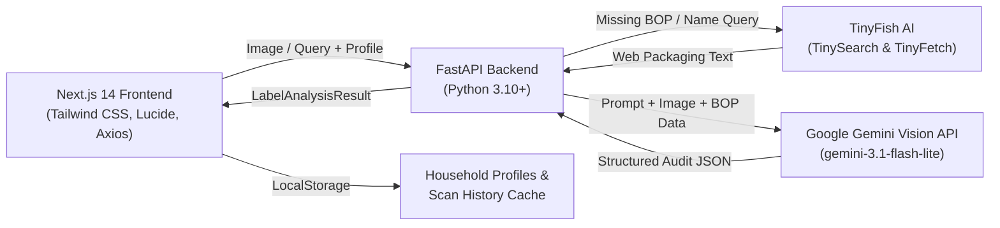

# 🔍 LabelTruth

> **Transparent Food Labeling, FSSAI Regulatory Auditor & Clinical Health Engine**  
> Grounded in primary consumer research across 51 respondents ($N=51$) and powered by multimodal Gemini Vision & FSSAI 2020 regulatory compliance frameworks.

---

## 📌 Problem Overview
Front-of-pack claims in India frequently deceive consumers through sophisticated marketing tactics:
- **Disguised Sugars**: Brands split sugars into 3–4 aliases (maltodextrin, liquid glucose, invert syrup, dextrose) to prevent sugar from appearing as the first ingredient under FSSAI Regulation 5(2)(b).
- **Atta / Brown Bread Dyeing**: Products labeled as "Brown Bread" or "Atta" often use Maida as the primary grain and add INS 150d (Caramel Colour IV) to dye white flour brown.
- **The "Ice Cream" Loophole**: Substituting milk fat with hydrogenated vegetable oils legally turns ice cream into a "Frozen Dessert," yet packaging mimics dairy ice cream.
- **Health Profile Mismatches**: Individuals with diabetes, hypertension, celiac disease, or food allergies lack real-time tools to cross-reference ambiguous chemical additives against their specific clinical restrictions.

**LabelTruth** solves this by offering a zero-hardcoded-product, 100% dynamic AI audit engine that reads real food labels, flags deceptive marketing, audits FSSAI compliance, checks personalized medical safety, and provides clean whole-food alternatives.

---

## ✨ Core Features

### 1. 📷 Smart Hybrid Scanner & TinyFish Fallback Engine (`/scan`)
- **Direct Text Search**: No photo? Type any packaged product name (e.g. *"Bournvita Little Champs"*, *"Epigamia Greek Yogurt"*) or paste a quick-commerce URL to auto-extract packaging data.
- **Live Camera Stream**: Real-time camera feed via HTML5 `navigator.mediaDevices.getUserMedia` for instant packaging capture.
- **File Upload / Drag-and-Drop**: Upload screenshots from quick-commerce apps (Blinkit, Zepto, Swiggy Instamart, Amazon).
- **Comprehensive Partial Photo Logic**:
  - *Front-of-pack only*: Automatically extracts product name and invokes TinyFish to pull back-of-pack ingredients and nutrition.
  - *Ingredients only*: Detects absence of nutrition facts and fetches the complete nutritional table online.
  - *Nutrition card only*: Detects absence of ingredients and fetches the full ingredient breakdown online.
- **Non-Food Image Guard**: Gemini Vision rejects irrelevant non-food photos (e.g., animals, cars, walls) with a clean HTTP 400 rejection.

### 2. 🐟 TinyFish AI Web Search & Extraction Integration
LabelTruth integrates **TinyFish AI** as an autonomous web agent layer for real-time quick-commerce search and back-of-pack data extraction:
- **TinySearch (`api.search.tinyfish.ai/search`)**: Queries Indian quick-commerce platforms (Blinkit, Zepto, Swiggy Instamart) with targeted product search queries to locate verified product listing URLs.
- **TinyFetch (`api.fetch.tinyfish.ai/fetch`)**: Deep-fetches and parses unstructured DOM content from online product listings, isolating ingredient lists, allergen statements, and nutrition tables.
- **Autonomous BOP Enrichment**: Seamlessly bridges the gap when users only upload a marketing front label or provide a product title.

### 3. 📊 Full Nutrient Card Decoder & Bioavailability Engine
- **Decoded Nutrition Facts Panel**: Parses energy, total fats, saturated fat, trans fat, total carbohydrates, added sugars, and sodium per 100g.
- **Line-by-Line Clinical Evaluation**: Computes `% RDA / Daily Value` and delivers forensic clinical commentary on excess sugars, sodium spikes, and industrial additives.
- **Protein Reality & PDCAAS Bioavailability**: Calculates declared protein vs. actual usable bioavailable protein adjusted by PDCAAS score (0.0 to 1.0), audits protein-to-calorie percentage, and exposes non-protein nitrogen amino spiking (added free glycine/taurine).
- **Hidden Fats & Sugars Matrix**: Exposes palm oil hidden behind "0% Cholesterol" claims and detects disguised sugar aliases (maltodextrin, invert syrup, liquid glucose).

### 4. 👨‍👩‍👧 Multi-Profile Household System
- **Household Member Switcher**: Seamlessly switch between active family profiles directly on the scan screen:
  - 👤 **Self**: Active / Fitness focus (monitors PDCAAS protein, artificial additives).
  - 👴 **Dad**: Type-2 Diabetes & Hypertension (monitors glycemic index, sodium, maltodextrin).
  - 👧 **Kid**: Allergies & Clean Growth (strictly flags artificial colorants INS 102/150d, peanuts, soy).
- **Add Family Members**: Easily create custom profiles (e.g. Mom, Toddler, Grandma) with dedicated dietary and clinical restrictions.
- **Dynamic Profile Badges**: Real-time tags reflect actual conditions, allergies, and custom avoidances rather than static labels.

### 5. 🛒 Clean Whole-Food Alternatives & Multi-Store Quick-Commerce
- **Clean Indian Swaps**: Returns 2–3 wholesome, minimally processed Indian alternatives for flagged ultra-processed products.
- **Multi-Store Availability**: Instant 1-click buy buttons across **Blinkit**, **Zepto**, **Swiggy Instamart**, and **Amazon Fresh**.
- **City & Pincode Localization**: Live filter customizes store search links with user location for verified delivery availability.

### 6. 💬 Context-Aware Clinical AI Chatbot
- Sticky floating clinical assistant grounded in both the active product audit and the active family member's clinical context (e.g. evaluating for Dad with Type-2 Diabetes).

---

## 🏗️ Architecture & Tech Stack



- **Frontend**: Next.js 14 (App Router), React 18, TypeScript, Tailwind CSS ("Editorial Minimalist / Modern Clinical" theme), Lucide Icons, Axios.
- **Backend**: Python FastAPI, Uvicorn, Pydantic v2, `google-genai` SDK (`gemini-3.1-flash-lite`), Pillow.

---

## 🚀 Quickstart & Installation

### Prerequisites
- Node.js 18+ and npm
- Python 3.10+
- Google Gemini API Key ([Google AI Studio](https://aistudio.google.com/))

### 1. Clone & Set Up Environment Variables
```bash
# Clone the repository
git clone https://github.com/your-username/LabelTruth.git
cd LabelTruth

# Configure backend environment
cd backend
cp .env.example .env # or create .env
```
Inside `backend/.env`:
```env
GEMINI_API_KEY="YOUR_GEMINI_API_KEY_HERE"
HOST="0.0.0.0"
PORT=8000
```

Inside `frontend/.env.local`:
```env
NEXT_PUBLIC_API_URL="http://localhost:8000"
```

---

### 2. Start the Backend
```bash
cd backend
python -m venv venv
# On Windows:
venv\Scripts\activate
# On Linux/macOS:
source venv/bin/activate

pip install -r requirements.txt
python run.py
```
*Backend runs on `http://127.0.0.1:8000` (API documentation at `/docs`).*

---

### 3. Start the Frontend
```bash
cd frontend
npm install
npm run build
npm run start
# Or for development: npm run dev
```
*Frontend runs on `http://localhost:3000`.*

---

## 📡 API Reference

| Endpoint | Method | Payload / Params | Description |
|---|---|---|---|
| `/api/health` | `GET` | — | Health check status |
| `/api/stats` | `GET` | — | N=51 Primary Survey statistics & FSSAI norms |
| `/api/presets` | `GET` | — | Instant demo products & sample audits |
| `/api/analyze-label` | `POST` | `multipart/form-data`: `image` (file), `user_profile` (JSON string) | Multimodal Gemini Vision label audit |
| `/api/validate-condition` | `POST` | `{"condition": string}` | AI condition/additive validation |
| `/api/chat` | `POST` | `{"message": string, "history": [...], "user_profile": {...}, "product_context": {...}}` | Clinical grounded AI chatbot |

## 🧪 Testing

LabelTruth includes a comprehensive automated test suite for both backend APIs and frontend UI components:

### Run Backend Tests (Pytest)
Backend unit tests mock external Gemini Vision and GenAI network calls via `pytest-mock` so they execute 100% offline without requiring an active API key or consuming quota:
```bash
cd backend
python -m pytest tests/test_main.py -v
```
**Tests covered:**
- `test_health_check`: Verifies service status and heartbeat.
- `test_get_survey_and_fssai_stats`: Validates survey data ($N=51$) and FSSAI regulation schemas.
- `test_get_demo_presets`: Verifies rapid demonstration presets.
- `test_validate_condition`: Tests AI-driven health condition/additive verification with mock responses.
- `test_chat_endpoint`: Tests scope-locking and formatted nutritionist replies.
- `test_analyze_label_endpoint`: Tests multipart image upload parsing and structured FSSAI audits.

---

### Run Frontend Tests (Vitest & React Testing Library)
Frontend smoke and component tests verify rendering and accessibility:
```bash
cd frontend
npm test
```

---

### Continuous Integration (CI)
GitHub Actions automatically runs both backend Pytest and frontend Vitest suites on every push and pull request via [`.github/workflows/test.yml`](.github/workflows/test.yml).

---

## ⚖️ Legal & Medical Disclaimer
> **Disclaimer**: LabelTruth is an AI-powered educational and consumer protection tool designed to decode food labels, ingredient lists, and FSSAI regulatory compliance. It does not provide clinical medical diagnosis, treatment, or medical nutrition therapy. Always consult a qualified physician or registered dietitian for personal medical conditions.

